<<<<<<< HEAD
# Laporan Praktikum Lab 4 Web

## Layout Sederhana

Praktikum ini mempelajari penyusunan elemen halaman web menggunakan HTML dan CSS. Materi dimulai dengan mengamati susunan box sebelum dan sesudah memakai `float`, dilanjutkan dengan percobaan `clear`, lalu menerapkan konsep layout pada situs sederhana.

Implementasi pada repositori ini terdiri dari latihan box di `lab4_layout.html` dan situs beberapa halaman di `Lab4WebSederhana/`. Gambar pada setiap bagian berikut memperlihatkan hasil yang tersimpan di folder `screenshoot/`.

## Tujuan

- Mengamati susunan normal elemen block dan perubahan posisinya dengan `float`.
- Mempraktikkan `float: left`, `float: right`, dan penggunaan `clear` setelah elemen float.
- Menyusun kerangka halaman menggunakan header, navigasi, hero, konten utama, sidebar, dan footer.
- Menerapkan layout tersebut pada halaman Home, Artikel, About, dan Kontak.
=======
# LAPORAN PRAKTIKUM 4: CSS LAYOUT
**Mata Kuliah:** Pemrograman Web  
**Dosen Pengampu:** Agung Nugroho, M.Kom  
**Program Studi:** Teknik Informatika  
**Fakultas:** Teknik  
**Universitas:** Universitas Pelita Bangsa  

---

## Identitas Mahasiswa

| Keterangan | Data Mahasiswa |
| :--- | :--- |
| **Nama Lengkap** | **Jumari** |
| **NIM** | **312510077** |
| **Kelas** | Teknik Informatika |
| **Mata Kuliah** | Pemrograman Web |
| **Dosen Pengampu** | Agung Nugroho, M.Kom |
| **Instansi** | Universitas Pelita Bangsa |

---

## Tujuan Praktikum
1. Mahasiswa mampu memahami struktur dasar pembuatan Web Layout.
2. Mahasiswa mampu memahami konsep Box Element (Box Model) pada CSS.
3. Mahasiswa mampu memahami cara kerja dan implementasi CSS Floating.
4. Mahasiswa mampu memahami dan menerapkan elemen semantik HTML5 (*HTML5 Semantics Elements*).
5. Mahasiswa mampu membuat Layout Web Sederhana yang rapi, fungsional, dan terstruktur.

---

## Dasar Teori

<<<<<<< HEAD
```text
Lab4Web/
├── lab4_layout.html
├── Lab4WebSederhana/
│   ├── home.html
│   ├── artikel.html
│   ├── about.html
│   ├── kontak.html
│   └── style.css
├── screenshoot/
└── README.md
```

`lab4_layout.html` adalah latihan box element. Halaman-halaman di `Lab4WebSederhana/` berbagi aturan tampilan dari `style.css`.

## Praktikum

## 1. Percobaan Box Element

### Tanpa float

Ketiga box tampil sebagai elemen block yang memenuhi lebar area dan tersusun vertikal.

**Code CSS**
```
<style>
    div { padding: 10px; }
    .div1 { background: red; }
    .div2 { background: yellow; }
    .div3 { background: green; }
</style>

<section>
    <div class="div1">Div 1</div>
    <div class="div2">Div 2</div>
    <div class="div3">Div 3</div>
</section>
```

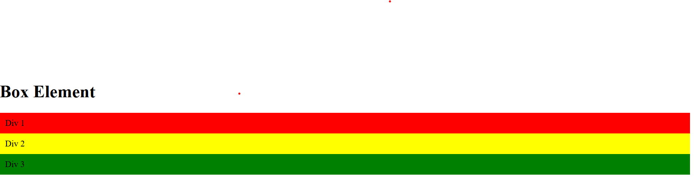

### Menggunakan float

Setelah elemen diberi float, Div 1, Div 2, dan Div 3 terlihat berdampingan di sisi kiri.

**Code css**
```
div {
    float: left;
    padding: 10px;
}
.div1 { background: red; }
.div2 { background: yellow; }
.div3 { background: green; }
```
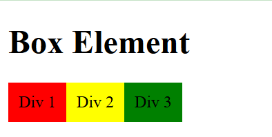

### Percobaan left, right, both, dan center

Screenshot memperlihatkan Div 1 di sisi kiri, Div 2 di sisi kanan, dan Div 3 di antara keduanya. Div 4 berada di baris berikutnya. Pada HTML latihan, `float: both` dan `float: center` bukan nilai CSS yang valid; `clear: left` dan `float: none` pada Div 4 membuatnya mulai setelah float di kiri.

**Code css**
```
 .div1 {
        float: left; */
        background: red;
      }
      .div2 {
        float: right;
        background: yellow;
      }
      .div3 {
        float: both;
        background: green;
      }
      .div4 {
        float: center;
        background-color: blue;
        clear: left;
        float: none;
      }
```
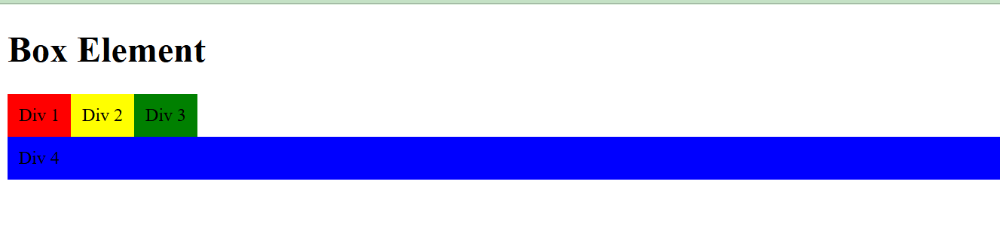

### Hasil percobaan clear

Pada screenshot ini, Div 1 dan Div 2 berada dalam satu baris, sementara Div 4 tampil sebagai blok biru pada baris setelah elemen float.

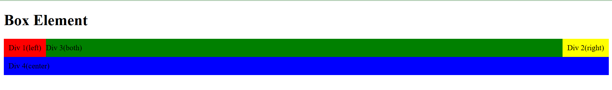

## 2. Penyusunan Layout Sederhana

Tahap ini menunjukkan perkembangan kerangka halaman dari header hingga hero dan footer. Beberapa screenshot merupakan potongan tampilan pada tahap tertentu, sehingga tidak semuanya memperlihatkan halaman lengkap.

### Kerangka layout

Kerangka awal menampilkan judul “Layout Sederhana”, navigasi Beranda/Artikel/About/Kontak, dan teks copyright.

**code html**
```
<!doctype html>
<html lang="en">
  <head>
    <meta charset="UTF-8" />
    <meta name="viewport" content="width=device-width, initial-scale=1.0" />
    <title>Layout Sederhana</title>
    <link rel="stylesheet" href="style.css" />
  </head>
  <body>
    <div id="container">
      <header>
        <h1>Layout Sederhana</h1>
      </header>
      <nav>
        <a href="home.html" class="active">Home</a>
        <a href="artikel.html">Artikel</a>
        <a href="about.html">About</a>
        <a href="kontak.html">Kontak</a>
```      
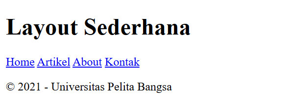

### Header dan navigasi

Tahap header menampilkan judul merah “Layout Sederhana”.

**code html**
```
div id="container">
      <header>
        <h1>Layout Sederhana</h1>
      </header>

**code css**

/* header */
header {
  padding: 20px;
}
header h1 {
  margin: 20px 10px;
  color: #a71616;
}
```
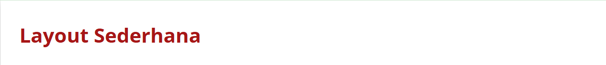

Navigasi menambahkan menu hero pada section id="hero"

**code html**
```
<section id="hero">
        <h1>Hello World!</h1>
        <p>
          Lorem ipsum dolor sit amet, consectetur adipiscing elit. Vestibulum
          lorem elit, iaculis innisl volutpat, malesuada tincidunt arcu. Proin
          in leo fringilla, vestibulum mi porta, faucibus felis. Integer
          pharetra est nunc, nec pretium nunc pretium ac.
        </p>
   
**code css**

body {
  line-height: 1;
  font-size: 100%;
  font-family: "Open Sans", sans-serif;
  color: #5a5a5a;
```     
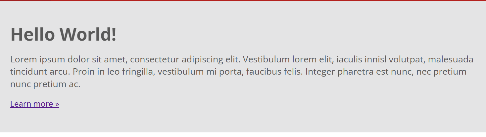

### Navigasi

Menambahkan gaya pada bilah navigasi 

**code html**
```
<nav>
        <a href="home.html" class="active">Home</a>
        <a href="artikel.html">Artikel</a>
        <a href="about.html">About</a>
        <a href="kontak.html">Kontak</a>
      </nav>

**code css**

nav {
  display: block;
  background-color: #b31e1b;
}
nav a {
  padding: 15px 30px;
  display: inline-block;
  color: #ffffff;
  font-size: 14px;
  text-decoration: none;
  font-weight: bold;
}
nav a.active,
nav a:hover {
  background-color: #a11d1d;
```
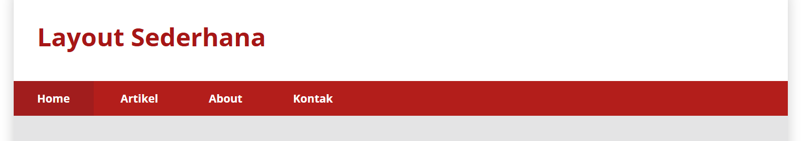

### Sidebar, dan main content

Sidebar berisi widget “Widget Header” dengan daftar tautan dan widget “Widget Text”.

**code html main content**
```
<div class="row">
            <div class="box">
              
              <h3>Heading</h3>
              <p>
                Donec sed odio dui. Etiam porta sem malesuada magna mollis
                euismod.
              </p>
              <a href="#" class="btn btn-default">View detail</a>
            </div>
            <div class="box">
              
              <h3>Heading</h3>
              <p>
                Donec sed odio dui. Etiam porta sem malesuada magna mollis
                euismod.
              </p>
              <a href="#" class="btn btn-default">View detail</a>
            </div>
            <div class="box">
              
              <h3>Heading</h3>
              <p>
                Donec sed odio dui. Etiam porta sem malesuada magna mollis
                euismod.
              </p>

**code html sidebar**

 <aside id="sidebar">
          <div class="widget-box">
            <h3 class="title">Widget Header</h3>
            <ul>
              <li><a href="#">Widget Link</a></li>
              <li><a href="#">Widget Link</a></li>
              <li><a href="#">Widget Link</a></li>
              <li><a href="#">Widget Link</a></li>
              <li><a href="#">Widget Link</a></li>
            </ul>
          </div>
          <div class="widget-box">
            <h3 class="title">Widget Text</h3>
            <p>
              Vestibulum lorem elit, iaculis in nisl volutpat, malesuada
              tincidunt arcu. Proin in leo fringilla, vestibulum mi porta,
              faucibus felis. Integer pharetra est nunc, nec pretium nunc
              pretium ac.
            </p>
          </div>
        </aside>        

**css main content dan sidebar dan widget box**

/* main content */
#wrapper {
  margin: 0;
}
#main {
  float: left;
  width: 640px;
  padding: 20px;
}
/* sidebar area */
#sidebar {
  float: left;
  width: 260px;
  padding: 20px;
}
/* widget */
.widget-box {
  border: 1px solid #eee;
  margin-bottom: 20px;
}
.widget-box .title {
  padding: 10px 16px;
  background-color: #a11d1d;
  color: #fff;
}
.widget-box ul {
  list-style-type: none;
}
.widget-box li {
  border-bottom: 1px solid #eee;
}
.widget-box li a {
  padding: 10px 16px;
  color: #333;
  display: block;
  text-decoration: none;
}
.widget-box li:hover a {
  background-color: #eee;
}
.widget-box p {
  padding: 15px;
  line-height: 25px;
}
```
Konten utama menampilkan tiga box dengan gambar lingkaran, heading, deskripsi, dan tautan “View detail”, berdampingan dengan widget sidebar.

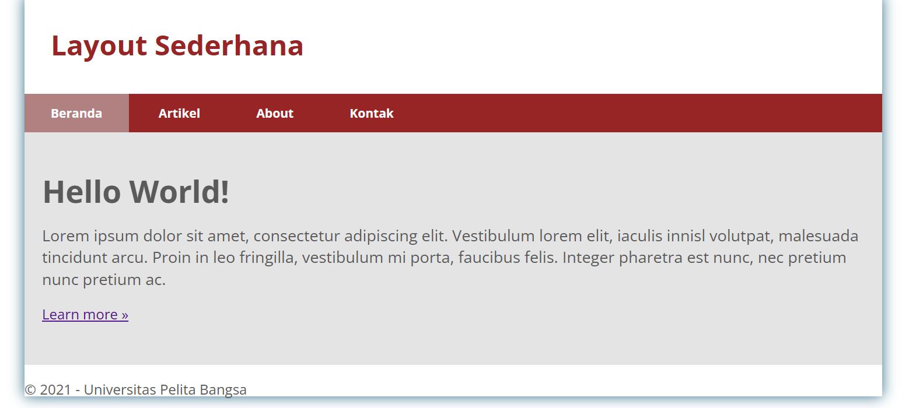

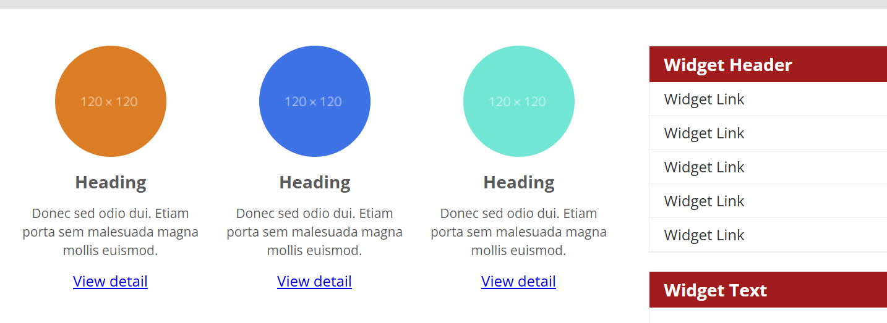

## Artikel
Membuat artikel yang terpisah dari main content

**code html**
```
 <article class="entry">
            <h2>First featurette heading.</h2>
            
            <p>
              Lorem ipsum dolor sit amet, consectetur adipiscing elit.
              Vestibulum lorem elit, iaculis in nisl volutpat, malesuada
              tincidunt arcu. Proin in leo fringilla, vestibulum mi porta,
              faucibus felis. Integer pharetra est nunc, nec pretium nunc
              pretium ac.
            </p>
          </article>
          <hr class="divider" />
          <article class="entry">
            <h2>First featurette heading.</h2>

            

            <p>
              Lorem ipsum dolor sit amet, consectetur adipiscing elit.
              Vestibulum lorem elit, iaculis in nisl volutpat, malesuada
              tincidunt arcu. Proin in leo fringilla, vestibulum mi porta,
              faucibus felis. Integer pharetra est nunc, nec pretium nunc
              pretium ac.
            </p>
          </article>
        </section>
        <aside id="sidebar">
          <div class="widget-box">
            <h3 class="title">Widget Header</h3>
            <ul>
              <li><a href="#">Widget Link</a></li>
              <li><a href="#">Widget Link</a></li>
              <li><a href="#">Widget Link</a></li>
              <li><a href="#">Widget Link</a></li>
              <li><a href="#">Widget Link</a></li>
            </ul>
          </div>
          <div class="widget-box">
            <h3 class="title">Widget Text</h3>
            <p>
              Vestibulum lorem elit, iaculis in nisl volutpat, malesuada
              tincidunt arcu. Proin in leo fringilla, vestibulum mi porta,
              faucibus felis. Integer pharetra est nunc, nec pretium nunc
              pretium ac.
            </p>
          </div>
        </aside>

**Code css artikel**

/* entry */
.entry {
  margin: 15px 0;
}
.entry h2 {
  margin-bottom: 20px;
}
.entry p {
  line-height: 25px;
}
.entry img {
  float: left;
  border-radius: 5px;
  margin-right: 15px;
}
.entry .right-img {
  float: right;
}
```
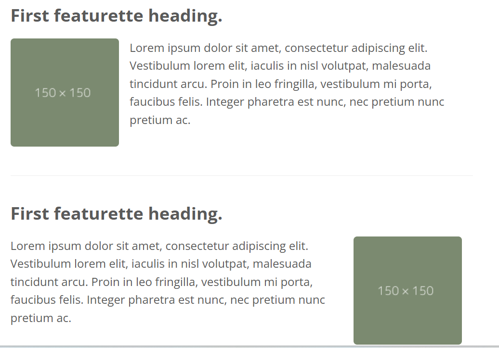

## footer

Bagian footer diberikan properti clear: both; agar posisinya selalu berada di bawah kolom main dan sidebar

**coding html**
```
 <footer>
        <p>&copy; 2021 - Universitas Pelita Bangsa</p>
      </footer>
      
**coding css**

footer {
  clear: both;
  background-color: #a11d1d;
  padding: 20px;
  color: #eee;
```  
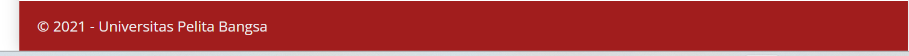
  
## 3. Halaman pada Lab4WebSederhana

Menu pada setiap halaman menghubungkan Home, Artikel, About, dan Kontak. Tampilan situs menggunakan stylesheet bersama `style.css`.

### Artikel

Screenshot halaman artikel memperlihatkan artikel “Kemajuan Teknologi AI: Transformasi di Era Digital”, gambar utama, isi artikel, kutipan, kategori artikel, dan daftar artikel populer.

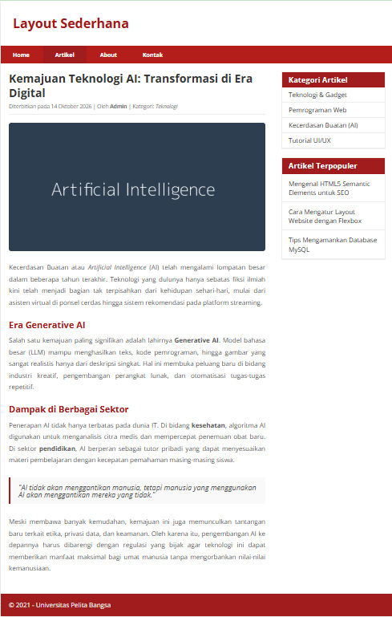

### About

Halaman About menampilkan kartu profil Jumari, deskripsi diri dan minat akademik, serta tiga kartu portofolio.

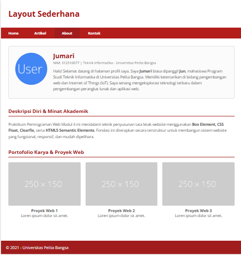

### Kontak

Halaman Kontak menampilkan formulir nama, email, telepon, pesan, tombol “Kirim Pesan”, informasi kontak, dan jam operasional.

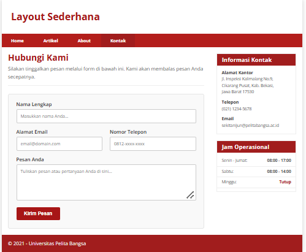

=======
### 1. Web Layout
Web layout merupakan kerangka acuan yang mengatur penempatan serta tata letak elemen pada halaman web, seperti navigasi, header, hero banner, main content, sidebar, dan footer. Penataan layout yang baik akan membuat halaman web lebih mudah dibaca, lebih rapi, dan lebih profesional.

### 2. Box Element (CSS Box Model)
Semua elemen dalam HTML pada dasarnya diperlakukan sebagai sebuah kotak (*box*). CSS Box Model tersusun atas empat komponen utama:
- **Content:** Area inti tempat teks, gambar, atau media ditampilkan.
- **Padding:** Ruang transparan di antara konten dan border elemen.
- **Border:** Garis pembatas yang mengelilingi padding dan konten.
- **Margin:** Ruang transparan di luar border yang memisahkan elemen tersebut dari elemen lainnya.
- **Box-sizing:** Deklarasi `box-sizing: border-box;` memastikan kalkulasi lebar total elemen sudah mencakup padding dan border.

### 3. CSS Float Property
Properti CSS `float` digunakan untuk menggeser elemen ke sisi kiri (`left`) atau kanan (`right`), sehingga elemen teks atau elemen lain di sekitarnya dapat mengalir di sampingnya. Elemen yang memiliki `float` akan keluar dari alur normal dokumen dan diletakkan pada sisi tertentu.

### 4. Clearfix Element
Ketika elemen-elemen anak (*child elements*) menggunakan `float`, elemen induk (*parent element*) sering kali kehilangan tinggi aslinya (*height collapse*). Untuk mengatasi hal ini, digunakan properti `clear` atau teknik clearfix agar elemen induk tetap menampung tinggi elemen-elemennya.

### 5. HTML5 Semantics Elements
HTML5 memperkenalkan elemen semantik yang memberikan makna struktural bagi peramban web (*browser*), perayap mesin pencari (*search engine bot*), dan pembaca layar (*screen reader*).
- `<header>`: Mendefinisikan kepala dokumen atau bagian pembuka.
- `<nav>`: Mendefinisikan kumpulan tautan navigasi utama.
- `<section>`: Mendefinisikan babak atau bagian tematik dalam dokumen.
- `<article>`: Mendefinisikan konten mandiri dan independen.
- `<aside>`: Mendefinisikan konten pelengkap/pendukung di samping konten utama (seperti *sidebar*).
- `<footer>`: Mendefinisikan kaki halaman atau bagian penutup.

<<<<<<< HEAD
Tidak diperlukan proses build atau instalasi. Buka `Lab4WebSederhana/home.html` di browser, lalu pilih halaman lain melalui menu navigasi. Latihan box dapat dibuka langsung melalui `lab4_layout.html`.

Gambar contoh pada halaman situs menggunakan `dummyimage.com`, dan font menggunakan Google Fonts, sehingga keduanya memerlukan koneksi internet.

## Catatan

- `float: both` dan `float: center` pada latihan tidak valid sebagai nilai properti CSS `float`; browser mengabaikannya.
- Formulir Kontak masih berupa antarmuka. `action="#"` belum mengirim atau menyimpan data ke backend.
- CSS menetapkan lebar container sebesar `980px`; screenshot menunjukkan hasil visual pada ukuran layar saat dokumentasi dibuat.
=======
---

